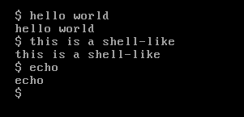

# What is this?
This is a basic kernel written for i686-elf that can display text to the screen via VGA and take in input using a PS/2 keyboard.



# Credit

Huge credit to the OSDEV wiki, many parts of my code were either inspired or taken directly from it You can find them at:

https://wiki.osdev.org/Expanded_Main_Page

# Installation

## Pre-setup

**Make sure** that you have a cross-compiler for `i686-elf` and that there is the necessary `i686-elf-gcc` and `i686-elf-as` in `$PATH`.

Do not use your system `gcc` for building the kernel. You must build a cross-compiler from source.

An amazing guide to do this can be found at:
https://wiki.osdev.org/GCC_Cross-Compiler

Note the versions I used:
  GNU GCC 16.2.0
  GNU Binutils 2.47

## Setup

Ensure you are in a linux/WSL environment.
Also ensure you have the dependencies installed
*Note: You may omit qemu if you are not planning to emulate/virtualize it or planning to do so another way*

Debian/Ubuntu:

`sudo apt update && sudo apt install git build-essential mtools xorriso grub-pc-bin grub-efi-amd64-bin nasm qemu-system-x86`

Fedora:

`sudo dnf install git @development-tools mtools xorriso grub2 grub2-efi-x64 nasm qemu-system-x86`

Arch:

`sudo pacman -S git base-devel mtools xorriso grub nasm qemu-desktop`

## Install

Open a terminal in a preferably empty directory.
Run the following:

```sh
git clone https://github.com/Advaith-Hello/KernelProject.git/
cd KernelProject/
make
```

There should now be a `bin` folder, inside of which you'll find a `kernel.bin` and `myos.iso`.

## Running
The best way to run this is to emulate/virtualize with qemu.

You can simply run:
`./run.sh`

It should open up a window for you with the OS.

